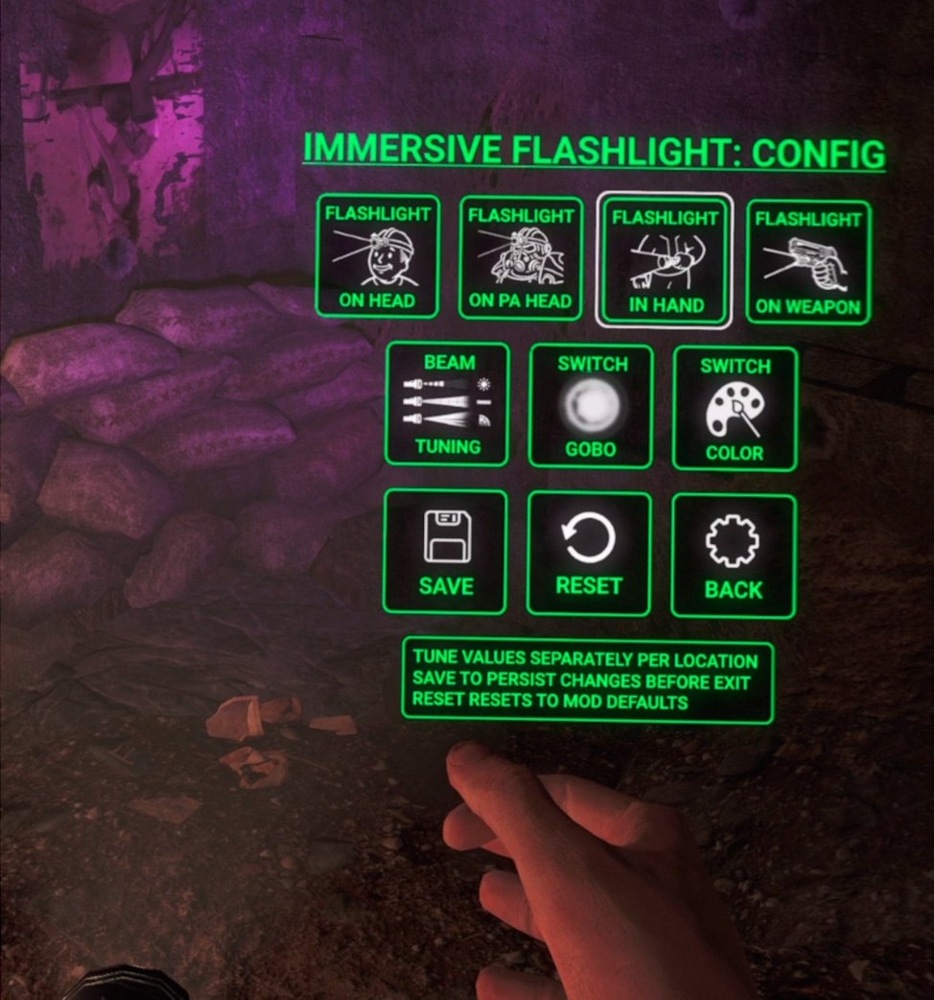
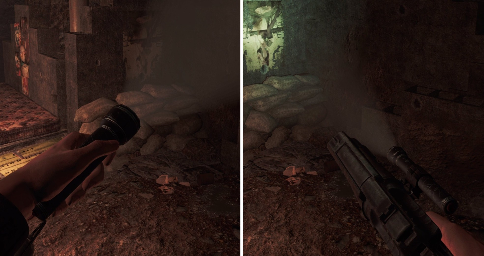
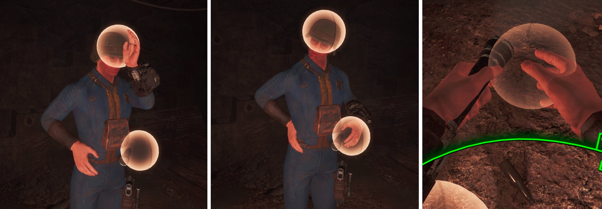
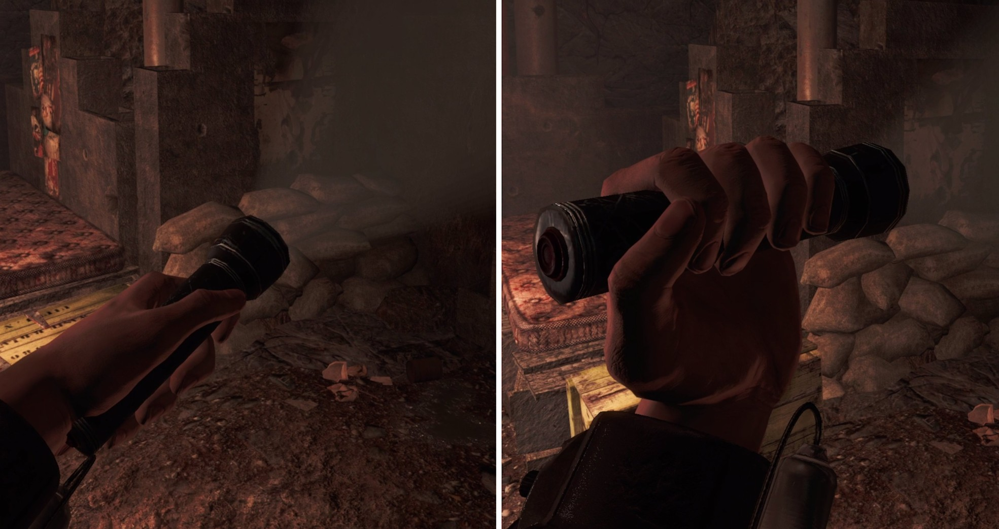
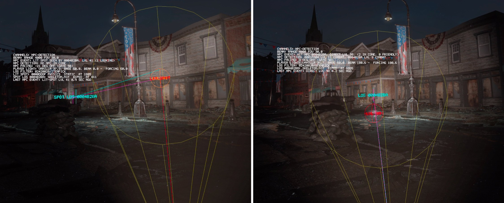

# Usage and Configuration Guide

A VR replacement for the Pip-Boy flashlight: hold it in either hand, wear it on your head, or mount it on your weapon, each with its own beam. You move it with physical gestures, and every setting applies live.

Install and requirements: [main README](../README.md). Problems: [FAQ](faq.md). Release notes: [Changelog](changelog.md).

## Contents

- [Quick Start](#quick-start)
- [Settings](#settings)
- [Flashlight Locations](#flashlight-locations)
- [Gestures](#gestures)
- [Default Bindings](#default-bindings)
- [Beam](#beam)
- [Grip Styles](#grip-styles)
- [Restrictions](#restrictions)
- [NPC Light Detection](#npc-light-detection)
- [Mod Recommendations](#mod-recommendations)

## Quick Start

- **Take the light:** reach a hand to the flashlight on your chest and tap the trigger. Do the same again to put it back and turn it off.
- **Wear it on your head:** bring your offhand near your head until you feel the haptic tick, then tap the trigger.
- **Move it to your hand or weapon:** bring your offhand near your primary hand (or the flashlight on your gun), then tap the trigger.
- **Two-handed weapons:** tap the offhand trigger while gripping the weapon to toggle the weapon light.
- **Vanilla toggle:** the game's long-press of the offhand trigger still turns the light on and off, unless you disable it.
- **Settings:** open [Mods Config FO4 VR](#settings) and pick Immersive Flashlight VR.
- **Shadows:** set the game's Shadow Quality to **HIGH**, or the beam's shadows look broken (see the [FAQ](faq.md#visuals)).

The gestures start working once you've picked up the Pip-Boy. They also pause while a menu that takes the controllers is open: workbench, container, terminal, dialogue. The Pip-Boy, scopes and VATS don't pause them.

## Settings

Settings are edited in game with [Mods Config FO4 VR](https://www.nexusmods.com/games/fallout4/mods/110945). Press in both thumbsticks and hold them to open it, then pick **Immersive Flashlight VR**. Changes apply as you make them. Save keeps them, and Discard undoes them.

| Page | What's there |
| --- | --- |
| **General** | Where the light goes in and out of power armor, shadows, keeping the light on in the Pip-Boy, the vanilla toggle, the chest flashlight, the headgear and weapon-flashlight requirements, and enemy light detection. |
| **Beam** | Each location's intensity, distance, spread, color and gobo, and the head light's angle. The beam glow. **Tune the beams in the world** opens the in-world tuning. |
| **Gestures** | Each gesture's zone, buttons, haptics, icon and sphere, and the two-handed weapon toggle. **Show all activation spheres** draws every zone at its true size. |
| **Advanced** | Grip detection, the flashlight model's and the light's placement in the hand, the chest model's placement, the weapon-lamp mount, and the NPC detection tuning. |

### Tuning the beam in the world

**Tune the beams in the world**, on the Beam page, sets the menu aside and opens a panel on your primary hand:

- **Location buttons:** light the beam at that location, so you tune it against the real scene. The on-weapon beam can be tuned without a weapon in hand.
- **Beam tuning:** the primary thumbstick changes intensity (up/down) and distance (left/right), and the offhand thumbstick changes spread (up/down). A panel shows the three values.
- **Gobo and color:** step through the presets.
- **Reset:** returns the location to the mod's defaults.
- **Exit:** brings the menu back with your changes pending there. Save or Discard them in the menu.

### The config file

Everything is also in the config file, which the game reloads as soon as you save it:

- Config: `%USERPROFILE%\Documents\My Games\Fallout4VR\Mods_Config\ImmersiveFlashlightVR\ImmersiveFlashlightVR.toml`
- Log: `%USERPROFILE%\Documents\My Games\Fallout4VR\F4SE\ImmersiveFlashlightVR.log`

The file is TOML: text in quotes, Windows paths in single quotes. A transform is `{ pos = [x, y, z], rot = [heading, roll, attitude], scale = s }`, a color is `{ rgb = [r, g, b] }`, and a list is `["a", "b"]`. The common settings are in `[ImmersiveFlashlightVR]`, and each advanced feature has its own `[ImFl_*]` section.

## Flashlight Locations

- **In hand:** in either hand, pointing where the controller points, with a flashlight model in the hand.
- **On head:** a cap lamp that follows where you look.
- **On weapon:** on a drawn ranged weapon, aligned with the barrel, including two-handed grips. On a gun with a modeled flashlight, the beam comes from that lamp.
- **Power-armor head:** the helmet lamp in power armor. It has its own beam, brighter and longer-range by default.

The location is remembered separately in and out of power armor.

### Automatic switching

- **Light in the primary hand:** it moves onto a drawn ranged weapon, and turns off with a melee or unarmed weapon drawn, as the hand is busy.
- **Light in the offhand:** it moves onto the weapon while you grip it two-handed, and comes back when you let go. If the [weapon-flashlight requirement](weapon-mount-restriction.md) is on and the gun has no lamp, it goes to your head instead.

### Power armor

Power armor poses the hands differently, so the model placement, hand poses and chest model have their own power-armor values. The beams are shared, except the head, which uses the helmet lamp and ignores the headgear requirement.

### Weapons in the offhand (ROCK)

With [ROCK](https://github.com/brunocatani/ROCK) v0.9 or newer handling your weapons, the light follows how the weapon is held:

- **Two-handed grip:** the light goes on the weapon.
- **Pistol fired from the offhand:** the light goes to your free primary hand.
- **Rifle carried by the offhand without firing:** the light stays on the weapon, unless you put it into the free hand with a gesture.

While the offhand holds the weapon, your primary hand takes over the head gesture and the chest grab. The move-to-hand gesture is off then, and so is the two-handed toggle while the offhand fires.

Known limitation: while ROCK fires from the left hand, the mod's primary-hand haptics are felt in the offhand.

## Gestures

Each gesture has a zone. A haptic tick tells you when your hand enters it, and the button is taken from the game only while the gesture can do something. Every gesture can be rebound or turned off on the Gestures page.

### Chest flashlight

The flashlight sits on your chest while the light is off, on your head or on your weapon.

- **Grab:** a hand in its zone, then a tap of the trigger, takes the light into that hand, turned on.
- **Put back:** the same with the hand holding it turns it off.
- A hand holding a drawn weapon can't grab or put back.
- A small flashlight icon marks the zone while your hand is inside it.

### Head

- **Tap** near your head: puts the light on your head, or turns it off when it's already there.
- **Long-press** near your head: pulls a head light back to your offhand.

### Hand or weapon

Bring your offhand near your primary hand and **tap**:

| The light is | What happens |
| --- | --- |
| In the offhand, primary hand empty | Moves to the primary hand |
| In the offhand, ranged weapon drawn | Moves onto the weapon |
| On the weapon | Turns off |
| In the primary hand | Moves back to the offhand |
| On the head, ranged weapon drawn | Moves onto the weapon |
| Off, ranged weapon drawn | Turns on, on the weapon |

With a melee weapon drawn, or with the light off and no weapon drawn, nothing happens. A **long-press** pulls a weapon light back to your offhand. When a gun's modeled lamp is detected, this zone moves to the lamp, so you reach for the flashlight on the gun.

### Two-handed toggle

Gripping a weapon two-handed, your offhand can't reach that zone, so a tap of the offhand trigger toggles the weapon light instead. Your chosen location stays the same.

## Default Bindings

| Gesture | Config section → key | Default |
| --- | --- | --- |
| Grab / put back, offhand | `[ImFl_BodyActivationSphere]` → `kPrimaryBinding` | offhand tap trigger |
| Grab / put back, primary hand | `[ImFl_BodyActivationSphere]` → `kSecondaryBinding` | primary tap trigger |
| Light on head / off | `[ImFl_HeadActivationSphere]` → `kPrimaryBinding` | offhand tap trigger |
| Head light to offhand | `[ImFl_HeadActivationSphere]` → `kSecondaryBinding` | offhand long-press trigger |
| Light to primary hand / weapon | `[ImFl_PrimaryHandActivationSphere]` → `kPrimaryBinding` | offhand tap trigger |
| Weapon light to offhand | `[ImFl_PrimaryHandActivationSphere]` → `kSecondaryBinding` | offhand long-press trigger |
| Weapon light, two-handed | `[ImFl_WeaponMount]` → `kToggleWeaponFlashlightTwoHandedBinding` | offhand tap trigger |

The offhand tap is shared on purpose. The gestures apply in situations that don't overlap, so only one fires. In the file a binding is `{ hand = "offhand", type = "tap", button = "trigger" }`, and `{ type = "none" }` turns it off. The full syntax is in the [framework's input-binding guide](https://github.com/ArthurHub/F4VR-CommonFramework/blob/main/docs/input-binding.md).

## Beam

Each location has its own beam:

- **Intensity:** how bright it is.
- **Distance:** how far it lights things.
- **Spread:** how wide the cone is.
- **Color:** the light's color.
- **Gobo:** the texture that shapes the beam: its rings, its edge and its falloff.

By default the head lamp is wide and soft for close spaces, the hand flashlight long and tight, and the weapon beam tighter still.

**Beam glow:** the flashlight in your hand and a gun's modeled lamp show a glow cone that takes the beam's color, spread and brightness as you tune. Its brightness and width are on the Beam page. Setting both brightness values to 0 hides it.

## Grip Styles

A hand-held light has two grips, each with its own light angle, model placement and hand pose:

- **Forward:** thumb up, controller top up.
- **Overhand:** fist or ice-pick grip, controller flipped, with the beam still pointing forward.

**Auto** (the default) picks the grip from how you tilt the controller. It can also be locked to one grip, on the Advanced page.

## Restrictions

Optional rules. When one isn't met, its light turns off and its gesture does nothing until it is.

- **Headgear for the head light** (out of power armor): not required, any headgear, or only light-capable helmets and hard hats (the default). See [Headgear Requirement](headgear-restriction.md).
- **A flashlight on the weapon:** the weapon light only goes on guns that carry a modeled flashlight, and comes from that lamp. By default it applies only with a supported weapon mod installed. See [Weapon Flashlight Requirement](weapon-mount-restriction.md).

## NPC Light Detection

The game ignores flashlights for stealth, and this mod makes the beam count:
- A lit flashlight makes you a little visible.
- Putting the beam on someone makes you much more visible.
- A bright beam in a hostile's face up close means they've seen you.

Line of sight is checked, so nothing is alerted through a wall. It's on by default, and you can switch it off on the General page. See [NPC Light Detection](npc-detection.md), and don't run it together with Flashlight Stealth Fix.

## Mod Recommendations

- [Comfort Swim VR](https://www.nexusmods.com/fallout4/mods/94647): better swimming in Fallout 4 VR.
- [Virtual Holsters](https://www.nexusmods.com/fallout4/mods/51224): body-based holstering.
