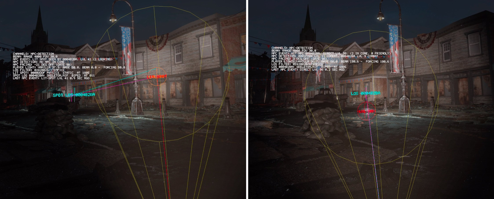

# NPC Light Detection

Your flashlight can give you away. Point the beam at a raider and they notice, and catch them full in the face up close and they come straight for you.

How the light works: [Usage and Configuration Guide](README.md). The engineering notes: [docs/tech/npc-light-detection.md](tech/npc-light-detection.md).

## Contents

- [How it works](#how-it-works)
- [Compared to Flashlight Stealth Fix](#compared-to-flashlight-stealth-fix)
- [Configuration](#configuration)

## How it works

The game only asks how lit the player is. A flashlight's beam points away from you, so it never counts: you can light a raider's chest from the dark and they won't react. This feature makes the beam count, and makes it depend on where you aim.

While the light is on, two things happen. Each can be turned off on its own.

### You become visible

- **Having the light on** makes you a little visible, sneaking or not.
- **Putting the beam on someone** makes you much more visible, more the brighter and closer the hit. A bright long-throw hand beam exposes you more than a dim head lamp.
- When the beam moves off, that **fades out** over a second, so a sweep doesn't flicker.

This is your own light level, so while it's raised every NPC who can see you sees it, not only the one you lit. Its ceiling is about "standing under a street light". It never makes you harder to see: in a bright room the beam adds nothing.

### NPCs investigate what the beam touches

About once a second, the mod checks what the beam hits:

- **Beam on an NPC:** the nearest one in the beam with a clear line of sight is alerted, toward you, so they turn and move to the light.
- **Beam in a hostile's face:** a bright, close hit on a hostile who faces you means they've **seen you**, and they come straight at you.
- **Beam on a wall or floor:** the lit patch alerts someone only if they're near it, facing it and able to see it.

Line of sight is checked, so nobody is alerted through cover. The cone that alerts is narrower and shorter than the beam you see, so the dim edge and the far end alert nobody. By default only hostiles react, and companions never do.

## Compared to Flashlight Stealth Fix

[Flashlight Stealth Fix](https://www.nexusmods.com/fallout4/mods/76586) solves the same problem differently.

|                | Flashlight Stealth Fix                     | This mod                                   |
| -------------- | ------------------------------------------ | ------------------------------------------ |
| Approach       | Papyrus + ESP + perk                       | Native code, no ESP                        |
| Requires       | BakaFramework, MCM, an ESP slot            | Nothing extra                              |
| Aim matters?   | **No**: the same penalty whichever way you point | **Yes**: only what the beam touches counts |
| Through walls? | Yes                                        | No: line of sight is checked               |
| Alert strength | Flat                                       | Scales with beam brightness and distance   |
| Alert position | Always on you                              | Where the beam lands                       |
| How often      | Every 3 seconds                            | About once a second                        |
| Works with     | Any flashlight, and flat Fallout 4         | This mod's flashlight, VR only             |

With Flashlight Stealth Fix, enemies turn even when your beam is on the floor behind you. Here, pointing away costs only the baseline. Its advantage is reach: it works with any flashlight, and in flat Fallout 4.

> **Don't run both.** They stack: this mod's visibility plus the perk's penalty, and two sets of alerts. Uninstall Flashlight Stealth Fix, or turn off **Enemies detect player light** here.

## Configuration

**Enemies detect player light** on the General page switches it all. The tuning is under Enemy light detection on the Advanced page, and in the config file's `[ImFl_NpcDetection]` section. Changes apply live.

### Who reacts

| In the menu | Setting | Default | Meaning |
| --- | --- | --- | --- |
| Enemies detect player light | `bNpcDetectionEnabled` | `true` | The whole feature. |
| Only while sneaking | `bNpcDetectionOnlyWhenSneaking` | `false` | Alert NPCs only while you sneak. Your visibility applies either way. |
| Only hostile | `bNpcDetectionOnlyHostileNpcs` | `true` | Only enemies react. Off: settlers and guards notice too. |

### How visible the light makes you

| In the menu | Setting | Default | Meaning |
| --- | --- | --- | --- |
| The light shows you | `bNpcDetectionLightLevelEnabled` | `true` | The beam makes you visible, apart from the alerts. |
| Lit while on | `fNpcDetectionLightLevelBaseline` | `40` | For having the light on. Keep it below the weak hit. |
| Lit by a weak hit | `fNpcDetectionLightLevelMin` | `70` | A weak or distant hit. |
| Lit by a close hit | `fNpcDetectionLightLevelMax` | `220` | A point-blank hit. |
| Brighten curve | `fNpcDetectionLightLevelCurve` | `1.0` | `1` rises evenly with distance; higher keeps you dim until the beam is close. |
| Fade out | `fNpcDetectionLightLevelDecayMs` | `1000` | How long it fades once the beam moves off, in ms. |

For scale: a dim interior is about 20 to 40, under a street light about 150, and bright indoor lighting up to 400.

### What NPCs notice

| In the menu | Setting | Default | Meaning |
| --- | --- | --- | --- |
| In the beam | `bNpcDetectionDirectEnabled` | `true` | Alert an NPC standing in the beam. |
| In the beam: how alarming | `iNpcDetectionDirectSoundLevel` | `100` | 0 to 500. |
| Where it lands | `bNpcDetectionLitSpotEnabled` | `true` | Alert on the lit patch when the beam hits nobody. |
| Where it lands: how alarming | `iNpcDetectionLitSpotSoundLevel` | `40` | 0 to 500. |
| Instant spot at | `iNpcDetectionSpottedEventLevel` | `100` | How hard the beam must land before they've seen you. Above 150, never. |

### Reach and timing

| In the menu | Setting | Default | Meaning |
| --- | --- | --- | --- |
| Reach | `fNpcDetectionMaxRange` | `4000` | The furthest the beam alerts anyone, in game units (about 100 per 1.4 m). |
| Lit part of the beam | `fNpcDetectionFovMult` | `0.5` | The part of the visible cone that counts. `1.0` alerts from the dim edge. |
| Check every | `iNpcDetectionIntervalMs` | `1000` | How often the beam is checked, in ms. |
| Line of sight filter | `sNpcDetectionLosCollisionFilter` | `02420028` | Which collision layers block line of sight. Leave it alone unless debugging. |

### Common adjustments

| Goal | Change |
| --- | --- |
| Keep the alerts, drop the visibility | **The light shows you** off |
| Keep the visibility, drop the alerts | **In the beam** and **Where it lands** off |
| Never get instantly spotted | **Instant spot at** above 150 |
| Carrying a light should cost more | **Lit while on** up |
| Caught too easily at range | **Brighten curve** up, or **Reach** down |
| Lit patches shouldn't give you away | **Where it lands** off |
